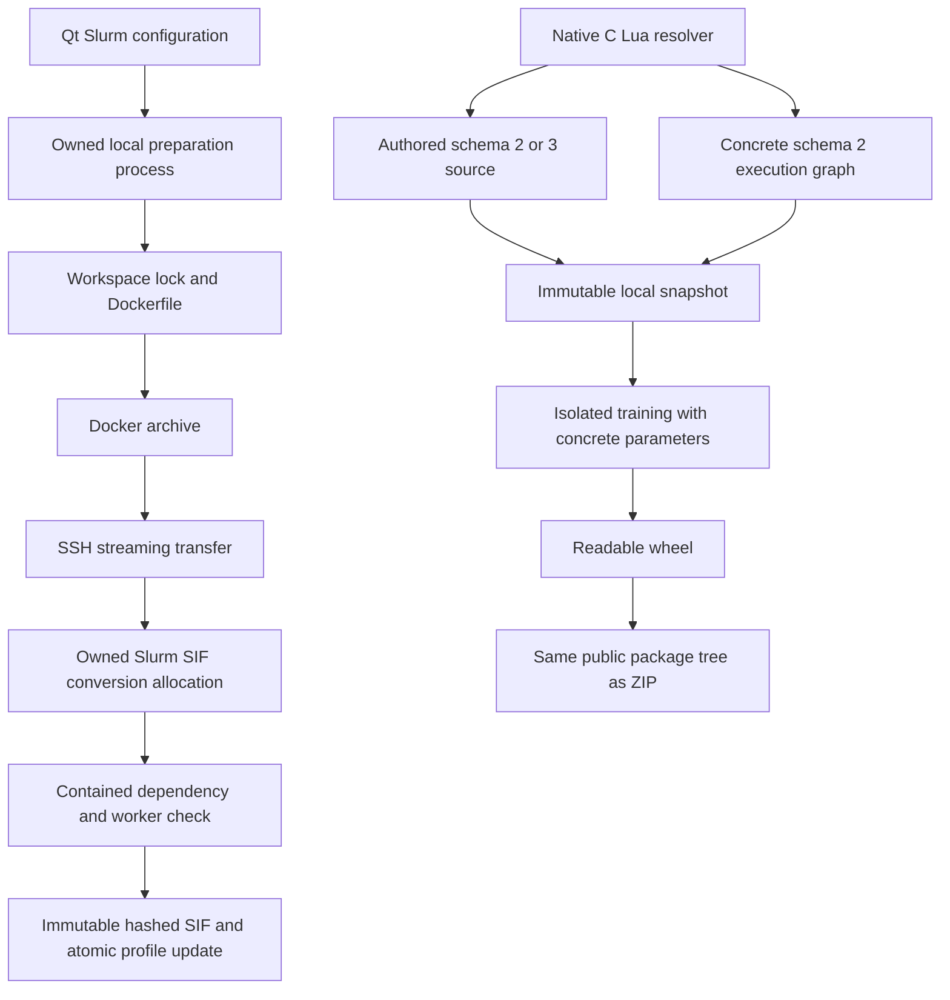
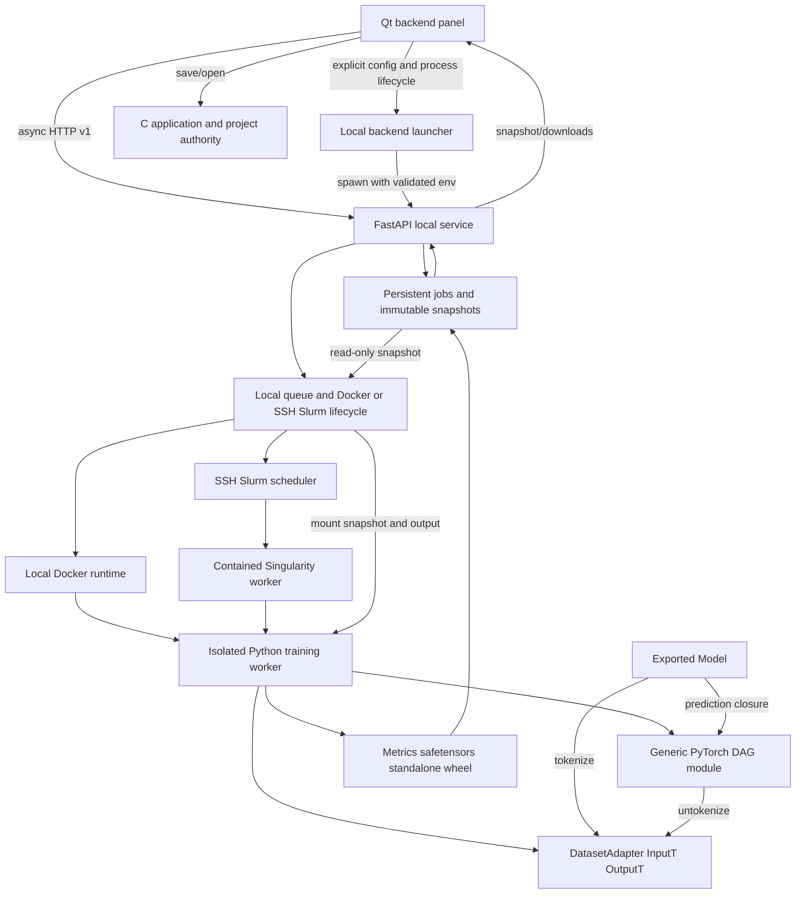

# Backend execution and snapshot ownership

## Preparation and compiled snapshots (accepted 2026-10-14)

Snapshot restore returns authored source; worker/export consume concrete graph.
Preparation environment is outside /app; source mounts cannot hide dependencies.
Profile/image publication follows successful verification only.

Accepted 2026-10-05. Normative protocol: [backend](../contracts/backend.md).
The diagrams below show component ownership; request and runtime sequences are
kept in the [backend sequence](sequences/backend-training.md).

Accepted 2026-10-12: tiny LLM resource definitions own attention width/head
count/dropout/bias and token-loss ignore-index/label-smoothing defaults. Catalog
and Lua validate metadata and shape constraints; resource Python builders consume
the same configuration. Causal-mask Lua and Python enforce the existing context
limit. Generic graph runtime and Qt inspector require no package-specific branch.

`GraphModule` owns registered runtime modules and derives its topological
execution order from frozen graph metadata. The worker owns optimizer, random seeds and metrics. `JobStore` owns
persisted job state, immutable request bytes and published output files. The
Qt panel owns transient controls and asynchronous replies; the main window owns
the optional local backend child process, and the shared per-user JSON profile owns its
non-secret launch profile. C still owns the active native project. Exported
`Model` owns a private dataset adapter, graph runtime and weights, without
training payloads.

Wheel export separates readable distribution identity (`nnm_<normalized-project-id>`)
and public Python package (`nnm_<normalized-project-id>`), with a job-specific
compatibility alias (`nnmodel_<normalized-job-id>`).
The API serves the stored artifact filename; old wheels remain unchanged.

Slurm execution keeps Store/API local. UUID job directories receive frozen snapshots
and worker source; per-allocation scheduler IDs are persisted for cancellation.
Warning signals checkpoint model, Adam, RNG, cursor and metric-window state as
safetensors plus JSON in remote output. Runner retrieves and validates handoff,
then submits another allocation against same logical job and remote directory.
Only final weights and wheel are served as artifacts after test evaluation.
Metrics and outputs return through bounded SSH transfers and existing local result
validation.

Accepted 2026-10-08: Slurm runner owns a separately recorded public HF corpus
preparation allocation before the isolated training allocation. Preparation
streams revision/size/hash-pinned files into a job-owned data root; training
binds it read-only and DatasetAdapter.data_directory resolves this root.
Cancellation covers the current recorded preparation or training scheduler ID.
GPU count flows Qt profile -> local service configuration -> sbatch GRES ->
Singularity --nv -> CUDA worker; unavailable CUDA is an error. Final artifacts
stream atomically; checkpoint tensors remain remote between allocations.
Worker owns mixed Muon/AdamW, device/autocast, accumulation, token count and CUDA
RNG; graph packages annotate optimizer exclusions without model-ID coupling.

GPU handoff reserve is min(300 seconds, allocation/4); CPU handoff retains
min(60 seconds, allocation/10), with a one-second lower bound.

MiniDeepSeek is an editable graph of repeated block subflows and component
nodes; no monolithic decoder owns the trainable model. Root batch-input context
serves declared input bindings through nested subflows, while their boundary
tensors and explicitly mapped outputs retain ordinary graph ownership.

Slurm startup publication: `SlurmRunner` polls the remote metrics file. A dedicated
missing-file status keeps the job running until the first atomic publication.
Transport errors and validation failures still fail the job; informational SSH
stderr is not used to decide whether the remote file exists.

Accepted 2026-10-09: new exports use project identity for both distribution and
public Python import; a thin job-specific alias preserves compatibility.
Worker owns epoch-based early stopping, minimum-validation tensor selection
and patience state. Checkpoint owns the same best state across Slurm handoff;
final test/export uses restored best weights. Qt presents frozen controls and
selection evidence, while JobStore validates optional early-stopping metrics.

Accepted 2026-10-12: Qt configuration -> QJsonDocument/QSaveFile -> per-user
config.json (atomic save). Standalone backend loads and validates the same
profile via standard json, then applies explicit environment overrides.
Cluster-specific fields have no defaults; profile errors remain visible and
prevent managed launch. No profile subprocess or additional parser dependency.
