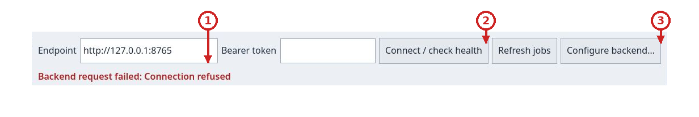
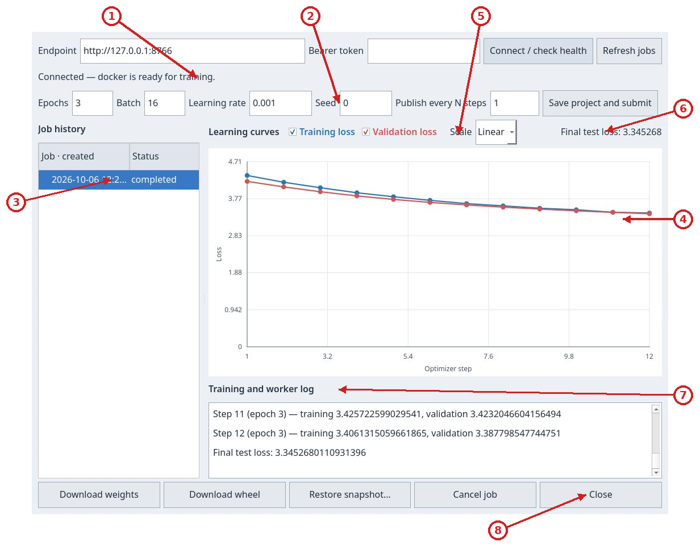
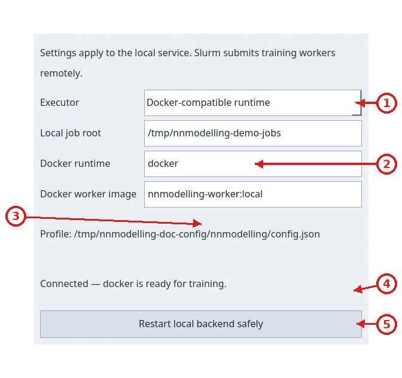
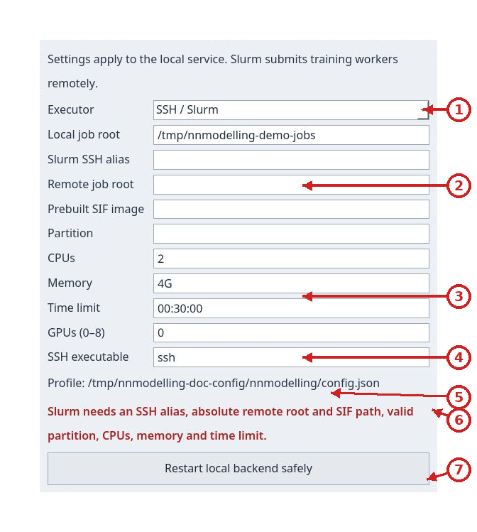
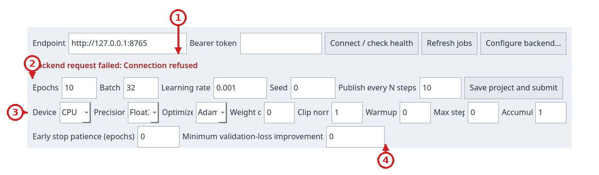

# Local backend and Slurm jobs

## Prepare and install a Slurm worker

Use `Prepare and install worker…` in backend configuration with your existing
SSH alias, remote paths, partition and resources. Preparation requires the
repository workspace, uv and Docker/Podman locally; SSH, Slurm and Singularity
remotely. Existing SSH agent/configuration handles authentication and host
verification. Passwords, keys and bearer tokens never enter the profile or logs.

The helper builds using the workspace lock, transfers a Docker archive, converts
it to SIF in an owned Slurm allocation, and checks Python dependencies and worker
startup. The UI presents phases, transfer bytes, errors and Cancel. Successful
verification selects an immutable hash-named SIF; failures retain the previous
image. `Check worker` probes the selected image. Start/restart the local backend
after preparation completes, with no queued/running jobs during restart.

Python environment lives at `/opt/nnmodelling/venv`, outside the `/app` source
bind. The standard lock selects CPU PyTorch; CUDA preparation needs compatible
locked dependencies and rejects a CPU-only image. Dependency installation takes
place during preparation; training remains network-isolated.

## Extract a Python package beside your script

New completed jobs provide `Download Python package`, a ZIP containing the same
public package as the wheel. Extract it beside caller code. For project ID
`tiny-decoder-llm`, use:

```python
from nnm_tiny_decoder_llm import Model

model = Model()
prediction = model.infer("ROMEO:\n")
```

The environment must already provide torch, NumPy, safetensors and declared
resource dependencies. Copying a `.whl` file does not install it. Extracted ZIP
includes weights, adapter and private runtime, without training data. Historical
jobs without ZIP retain their original wheel/weight downloads.

NNModelling submits an immutable project copy to the local FastAPI service. The service, API and job history stay on this computer. Jobs can run in a local container or be sent to Slurm over SSH; in the latter case only the worker runs on the cluster, while snapshots, metrics, logs and results return to the local backend. The **Training** window shows the connection, history, curves and controls to cancel jobs, restore snapshots and download results.





## Prepare and start the service

Run these Bash commands from the repository root. The token prompts use Bash `read -s`, and the reusable `AUTH` header later in this guide uses a Bash array. You need `uv`, `just` and an installed and running Docker-compatible runtime (Docker or Podman). The first command installs the workspace's locked dependencies; the second builds the CPU image used for training.

```sh
just backend-sync
just backend-image
just backend-run
```

`backend-run` stays in the foreground. The default address is `http://127.0.0.1:8765`; use another terminal to query the API and press **Ctrl-C** to stop the service. Select **Training** in the app and press **Connect / check health**. The endpoint field already contains the default address.

## Per-user JSON configuration

UI and backend read the same file: `~/.config/nnmodelling/config.json`.
When `XDG_CONFIG_HOME` is set, the path is
`$XDG_CONFIG_HOME/nnmodelling/config.json`. `NNMODELLING_CONFIG` selects an
alternate file. **Configure backend…** shows its path and saves non-secret
settings before starting the service. Old Qt launcher preferences are no longer
used. No host, account, remote path or partition is preconfigured.

You may create the file manually. This example uses placeholders: replace the
host, absolute paths and partition with values from your installation.

```json
{
  "backend": {
    "executor": "docker",
    "job_root": "~/.local/share/nnmodelling/jobs",
    "container_runtime": "docker",
    "worker_image": "nnmodelling-worker:local"
  },
  "slurm": {
    "host": "my-cluster",
    "root": "/srv/nnmodelling/jobs",
    "image": "/srv/nnmodelling/worker.sif",
    "partition": "my-partition",
    "cpus": 2,
    "memory": "4G",
    "time": "00:30:00",
    "gpus": 0,
    "ssh_executable": "ssh"
  }
}
```

For Slurm set `"executor": "slurm"`. A terminal-started backend uses explicit
`NNMODELLING_*` environment variables first, then JSON, then generic defaults.
The UI passes its selected field values to the service. An absent default file
allows local use; an explicitly selected missing file or invalid JSON reports
an error. Read/save errors prevent managed startup without overwriting the file.
Saving is atomic and preserves other JSON settings. Passwords, SSH keys and
bearer tokens do not belong in this file; tokens remain in memory and SSH
credentials stay in your SSH agent/configuration.

`just backend-image` reads runtime and image tag from environment variables:
pass matching values to the build command when you change them in JSON.



## Run jobs on a Slurm cluster from the UI

FastAPI, the Training dashboard and the job archive stay on this computer. The
**Local backend service configuration** window selects Slurm; only workers are
sent to the cluster over SSH. First prepare a writable remote directory and a
ready-to-use Singularity (`.sif`) image containing Python, PyTorch, NumPy,
safetensors and every dependency declared by project datasets and packages. The
cluster must provide `sbatch`, `squeue`, `sacct`, `scancel`, `singularity` and
`python3` over SSH. Jobs have no network access. Use an SSH alias already
configured on this computer, with normal authentication and host-key checks.

### 1. Prepare the image and remote directory

Replace the example SSH alias and paths with values for your account. Create
the directory once:

```sh
ssh my-cluster 'mkdir -p /srv/nnmodelling/jobs && chmod 700 /srv/nnmodelling/jobs'
```

The image must already contain every Python dependency required by the
project; jobs do not install packages. The local job directory stores snapshots,
metrics, logs and artifacts. The remote directory contains temporary execution
files for each job.

### 2. Open backend configuration and choose Slurm

In the **Training** dashboard, press **Configure backend…**. A separate window
opens while the dashboard with its endpoint, training controls, history and
curves remains available. Set `Executor` to `SSH / Slurm`, then enter the SSH
alias, local directory, remote directory, `.sif` image, partition, CPUs, memory
time limit and GPU count. Host, remote root, image and partition are required
and initially blank. Generic defaults are 2 CPUs, `4G`, `00:30:00` and 0 GPUs;
use the limits assigned to your account. `Time limit` applies to each Slurm
allocation, not to the total training duration.



### 3. Start FastAPI locally

In the configuration window, press **Save settings and start local backend**.
The screenshot shows blank remote fields: startup is rejected before any
cluster connection.
An active managed service changes the button to a safe restart action.
Only the local service starts, bound to loopback. The app chooses an available
port and fills `Endpoint` in the dashboard automatically. The status line
checks startup and Singularity availability; SSH, image and prerequisite
errors appear there. Non-secret preferences are saved for your user. The app
never asks for or copies an SSH password.

### 4. Connect the dashboard and submit

Return to the **Training** dashboard: `Endpoint` already contains the loopback
address chosen by the service. Press **Connect / check health** to refresh the
check if needed. Submit the project and parameters as with the local runtime:
the project needs no Slurm flags and model configuration stays the same.
Snapshots and results remain local; only the worker runs on the cluster.

As an allocation approaches its limit, the worker automatically saves a safe
checkpoint and submits another Slurm job that resumes from that point. The UI
continues to show one job and its metrics while the Slurm allocation IDs change.
Keep the local backend service running through these handoffs. If the cluster
ends an allocation before its warning signal or before the checkpoint is
complete, the job is marked failed and cannot resume automatically. Custom
training iterators must be repeatable so the worker can restore the saved
position.



The [LLM](tutorial-tiny-llm.md) and [VAE](tutorial-vae.md) tutorials follow the
same path. If a dependency is missing from the `.sif`, the job fails visibly;
rebuild the image before retrying. To return to local Docker execution, open
**Configure backend…**, select **Docker-compatible runtime** and start the
service.

The worker image includes the wheel exporter. After updating the repository to
use readable filenames, rebuild the worker image and restart the managed
backend before submitting more jobs. Rebuilding does not alter stored wheels;
they remain downloadable with their original names and contents. Do not rename
them manually.

### Example: port 8766 and a dedicated job store

To keep this instance separate, set a dedicated local store and use the same configuration in the service terminal:

```sh
export NNMODELLING_BACKEND_HOST=127.0.0.1
export NNMODELLING_BACKEND_PORT=8766
export NNMODELLING_JOB_ROOT="$HOME/.local/share/nnmodelling/jobs-8766"
export NNMODELLING_CONTAINER_RUNTIME=docker
export NNMODELLING_WORKER_IMAGE=nnmodelling-worker:local
just backend-image
just backend-run
```

In a second terminal, check the service:

```sh
curl -fsS http://127.0.0.1:8766/health
```

In the app, open **Training**, change the endpoint to `http://127.0.0.1:8766` and press **Connect / check health**. Look in `~/.local/share/nnmodelling/jobs-8766` for this instance's snapshots, logs and artifacts. Press **Ctrl-C** in the first terminal to stop it.

To use Podman or an image with additional dependencies, use the same runtime and image name when building and starting the service:

```sh
NNMODELLING_CONTAINER_RUNTIME=podman just backend-image
NNMODELLING_CONTAINER_RUNTIME=podman just backend-run
```

`NNMODELLING_WORKER_IMAGE` changes the image tag (default `nnmodelling-worker:local`). Training containers have no network access. Add dependencies declared by resources to the image before submitting a job.

If a resource needs `scikit-image`, you can build an additional image with a pinned version. Save this as `Dockerfile.worker-extra` in the repository root:

```dockerfile
FROM nnmodelling-worker:local
USER 0
RUN uv pip install --python /opt/nnmodelling/venv/bin/python 'scikit-image==0.25.2'
USER 65532:65532
```

Build the base image with the tag used by the Dockerfile, then build the extension and select it when starting the service:

```sh
export NNMODELLING_WORKER_IMAGE=nnmodelling-worker:local
just backend-image
docker build -f Dockerfile.worker-extra -t nnmodelling-worker:scikit-image .
export NNMODELLING_WORKER_IMAGE=nnmodelling-worker:scikit-image
just backend-run
```

With Podman, replace `docker build` with `podman build` and set `NNMODELLING_CONTAINER_RUNTIME=podman` before building the base and starting the service. Keep resource dependencies pinned in the image and rebuild it when they change.

## Optional bearer token

The token is optional for a single-user local session. To require one, set it before starting the service and enter the same value in the Training window's **Bearer token** field. The shell input below does not display the token while you type:

```sh
read -r -s -p 'Bearer token: ' NNMODELLING_BEARER_TOKEN
printf '\n'
export NNMODELLING_BEARER_TOKEN
just backend-run
```

The service keeps the token in memory only. The Qt client keeps it only in the current window and does not save it in the project or snapshot. Requests to `/v1/jobs` require `Authorization: Bearer …` when a token is configured; `/health` returns only service and runtime status. The service is intended for local use: keep its bind address on loopback, especially when no token is configured.

## Check the service

`GET /health` does not require authentication. `status: "ok"` means the API is responding; for training, `container.available` must also be `true`. `runtime` identifies the configured Docker-compatible command and `error` is `null` or the reason the runtime is unavailable.

```sh
curl -fsS http://127.0.0.1:8765/health
```

Example response with the Docker runtime:

```json
{"status":"ok","container":{"available":true,"runtime":"docker","error":null}}
```

With Slurm, the `container` object also reports `"executor":"slurm"` and
`"runtime":"singularity"`.

OpenAPI documentation is available at `http://127.0.0.1:8765/docs`.

## Submit a project

Save the project in the app before submission. In the Training window, set epochs, batch, learning rate, seed and **Publish every N steps**, then press **Save project and submit**. Initial values are `10`, `32`, `0.001`, `0` and `10`. The interval controls how often paired training and validation metrics are published; the remaining window is also published at the end of each epoch.

The API accepts these ranges: epochs `1–10000`, batch `1–4096`, finite learning rate greater than `0` and at most `1`, seed from `-2147483648` through `4294967295`, and publish interval `1–100000`. Unknown JSON fields are rejected; the advanced options listed in the client guide are supported. A job records its configuration and file snapshot: later project edits do not change a submitted job.

For a reproducible terminal submission, this example uses only the Python standard library. From the repository root, it creates an in-memory bundle of `examples/models/tiny-decoder-llm` and submits a short one-epoch configuration. File contents, order and parameters are fixed; the script creates no intermediate files. It excludes symbolic links, `env` directories, `.env`, `venv`, `.venv`, caches and bytecode, as well as application-generated folders. It also includes inference assets listed in resource manifests.

```sh
python3 - <<'PY'
import base64
import hashlib
import json
import os
from pathlib import Path, PurePosixPath
from urllib.request import Request, urlopen

base_url = os.environ.get("NNMODELLING_BACKEND_URL", "http://127.0.0.1:8765").rstrip("/")
root = Path.cwd() / "examples/models/tiny-decoder-llm"
if not root.is_dir() or root.is_symlink():
    raise FileNotFoundError(f"Example project directory does not exist: {root}")
model_bytes = (root / "model.json").read_bytes()
model = json.loads(model_bytes)
compiled_path = root / "execution-model.json"
if compiled_path.is_symlink():
    raise ValueError("Compiled example must not be a symlink")
compiled = json.loads(compiled_path.read_bytes())
if compiled["source_sha256"] != hashlib.sha256(model_bytes).hexdigest():
    raise ValueError("Example compilation is stale; submit edited models through Qt")
excluded = {
    ".venv", "venv", "env", ".env", "__pycache__", ".git", "build", "dist",
    "target", ".pytest_cache", ".nnmodelling-generated", "node_modules",
}
files = {}

def safe_relative(value):
    if not isinstance(value, str) or not value or "\\" in value or "\x00" in value:
        raise ValueError(f"Unsafe project-relative path: {value!r}")
    parts = value.split("/")
    if (PurePosixPath(value).is_absolute() or ":" in parts[0]
            or any(part in {"", ".", ".."} for part in parts)
            or value == "model.json"):
        raise ValueError(f"Unsafe project-relative path: {value!r}")
    return Path(*parts)

def excluded_path(relative):
    return (
        any(part in excluded for part in relative.parts)
        or relative.name == ".DS_Store"
        or relative.suffix in {".pyc", ".pyo"}
        or relative.name.endswith("~")
        or ".generated." in relative.name
    )

def add_tree(value, required=False):
    relative = safe_relative(value.as_posix() if isinstance(value, Path) else value)
    if excluded_path(relative):
        if required:
            raise ValueError(f"Required project resource is in an excluded directory: {relative}")
        return
    source = root / relative
    cursor = root
    for part in relative.parts:
        if part in {".", ".."}:
            raise ValueError(f"Unsafe project-relative path: {relative}")
        cursor = cursor / part
        if cursor.is_symlink():
            if required:
                raise ValueError(f"Required project resource uses a symlink: {relative}")
            return
    if source.is_symlink():
        if required:
            raise ValueError(f"Required project resource uses a symlink: {relative}")
        return
    if source.is_file():
        name = relative.as_posix()
        if name not in files:
            files[name] = base64.b64encode(source.read_bytes()).decode("ascii")
    elif source.is_dir():
        for child in sorted(source.iterdir(), key=lambda path: path.name):
            if not child.is_symlink():
                add_tree((relative / child.name).as_posix())
    elif required:
        raise FileNotFoundError(f"Project resource does not exist: {relative}")

for group in ("customPackages", "customDatasets"):
    for resource in model["manifest"].get(group, []):
        add_tree(resource["path"], required=True)
for folder in ("data", "resources"):
    add_tree(folder)

# A resource may declare inference assets outside the conventional directories.
for name, encoded in list(files.items()):
    if name.endswith("/manifest.json"):
        manifest = json.loads(base64.b64decode(encoded))
        for asset in manifest.get("inferenceAssets", []):
            add_tree(asset, required=True)

payload = {
    "project": model,
    "execution_project": compiled["execution_project"],
    "files": files,
    "training": {
        "epochs": 1,
        "batch_size": 8,
        "learning_rate": 0.001,
        "seed": 0,
        "publish_every_steps": 2,
    },
}
headers = {"Content-Type": "application/json", "Accept": "application/json"}
token = os.environ.get("NNMODELLING_BEARER_TOKEN")
if token:
    headers["Authorization"] = "Bearer " + token
request = Request(
    base_url + "/v1/jobs",
    data=json.dumps(payload, separators=(",", ":")).encode("utf-8"),
    headers=headers,
    method="POST",
)
with urlopen(request, timeout=30) as response:
    job = json.load(response)
    print("HTTP", response.status, "job", job["id"], "status", job["status"])
    print("Bundle files:", len(files))
PY
```

The `202` response contains `id`, `status` (`queued` at submission), `created_at`, `error` and `metrics`. Copy the returned ID for the following commands:

```sh
JOB_ID='paste-the-returned-id-here'
```

## Follow, cancel and retrieve a job

History in the app refreshes automatically. From a terminal, list jobs and read a selected job. If you configured a token, use the terminal separate from the one running the service. Enter the token there without displaying it, then prepare the header:

```sh
read -r -s -p 'Bearer token: ' NNMODELLING_BEARER_TOKEN
printf '\n'
export NNMODELLING_BEARER_TOKEN
```

In the same terminal, prepare a header for the following commands:

```sh
AUTH=()
if [[ -n "${NNMODELLING_BEARER_TOKEN:-}" ]]; then
  AUTH=(-H "Authorization: Bearer $NNMODELLING_BEARER_TOKEN")
fi
```

If the service has no token configured, skip the hidden prompt and initialize only `AUTH=()`; local requests are anonymous.

```sh
curl -fsS "${AUTH[@]}" http://127.0.0.1:8765/v1/jobs
curl -fsS "${AUTH[@]}" "http://127.0.0.1:8765/v1/jobs/$JOB_ID"
```

Status can be `queued`, `running`, `completed`, `failed` or `cancelled`. `metrics.epochs` contains per-epoch summaries; `metrics.steps` contains published points with step number, epoch, training loss and validation loss. `metrics.test_loss` remains `null` until the final evaluation is available. `error` reports why a job failed.

Cancelling a job acts on that job; it does not stop the API:

```sh
curl -fsS "${AUTH[@]}" -X POST -H 'Content-Type: application/json' -d '{}' \
  "http://127.0.0.1:8765/v1/jobs/$JOB_ID/cancel"
```

A queued job changes to `cancelled` immediately. For a running job, the response may still show `running` while the container shuts down; refresh the job to read its final status. Repeating the request for an already `cancelled` job is idempotent; completed or failed jobs return `409` and cannot be cancelled.

**Ctrl-C** in the `just backend-run` terminal stops the API service and starts shutdown of managed containers; it does not send a cancellation request for an individual job. If the API restarts while a job is still `running`, it records the job as `failed` with an interruption error. Queued jobs are recovered by the service.

The snapshot returns the model and original job files, with files encoded in Base64. Save it to inspect or restore it in the app:

```sh
curl -fsS "${AUTH[@]}" "http://127.0.0.1:8765/v1/jobs/$JOB_ID/snapshot" -o snapshot.json
```

## Download results

Weights and standalone wheels are available only when the status is `completed`:

```sh
curl -fS "${AUTH[@]}" "http://127.0.0.1:8765/v1/jobs/$JOB_ID/weights" -o weights.safetensors
mkdir -p artifacts
curl -fS --remote-name --remote-header-name --output-dir artifacts \
  "${AUTH[@]}" "http://127.0.0.1:8765/v1/jobs/$JOB_ID/wheel"
```

The app provides the same **Download weights** and **Download wheel** commands. New jobs use distribution name `nnm_<normalized-project-id>`; for example, project ID `llm` produces `nnm_llm-0.1.0-py3-none-any.whl`. Normalization replaces runs outside ASCII letters and digits with `_`, trims leading and trailing underscores, and lowercases the result. Qt preserves the full name supplied by the server, including distribution, version and tag. New wheels expose `nnm_<normalized-project-id>`: for project ID `llm`, use `from nnm_llm import Model`. A job-specific alias remains for compatibility. Inspect historical wheels to find their original import. Different jobs from the same project, or from projects whose IDs normalize to the same value, share a distribution name and version, so install them in separate Python environments. Wheels stored before this change keep their original names and contents; do not rename them manually. The wheel includes the model, its inference adapter and weights. Inference does not need the service or source project, but it does need Python, PyTorch, safetensors and the dependencies declared by the resource.

## Configuration

Set these variables before starting `just backend-run`.

| Variable | Default | Purpose and effective limits |
| --- | --- | --- |
| `NNMODELLING_CONFIG` | XDG path or `~/.config/nnmodelling/config.json` | Shared JSON profile; an explicitly selected missing file fails. |
| `NNMODELLING_EXECUTOR` | `docker` | `docker` or `slurm`; overrides `backend.executor`. |
| `NNMODELLING_SLURM_HOST`, `NNMODELLING_SLURM_ROOT`, `NNMODELLING_SLURM_IMAGE`, `NNMODELLING_SLURM_PARTITION` | empty | SSH alias, remote root, SIF and partition: required for Slurm. |
| `NNMODELLING_SLURM_CPUS`, `NNMODELLING_SLURM_MEMORY`, `NNMODELLING_SLURM_TIME`, `NNMODELLING_SLURM_GPUS` | `2`, `4G`, `00:30:00`, `0` | Per-allocation resources; GPU count 0 to 8. |
| `NNMODELLING_SSH_EXECUTABLE` | `ssh` | SSH command used by the service. |
| `NNMODELLING_MAX_ARTIFACT_BYTES` | `64 GiB` | Configurable artifact bound, separate from bundles and corpus. |
| `NNMODELLING_BACKEND_HOST` | `127.0.0.1` | Bind address passed to Uvicorn. Keep it on loopback for local use. |
| `NNMODELLING_BACKEND_PORT` | `8765` | Port passed to Uvicorn. |
| `NNMODELLING_JOB_ROOT` | `~/.local/share/nnmodelling/jobs` | Persistent directory for jobs, snapshots, logs and results. |
| `NNMODELLING_BEARER_TOKEN` | unset | When set, protects `/v1/jobs` routes. The token is not written to job records. |
| `NNMODELLING_CONTAINER_RUNTIME` | `docker` | Name or path of a Docker-compatible executable; it must be on `PATH`. |
| `NNMODELLING_WORKER_IMAGE` | `nnmodelling-worker:local` | Image used by `just backend-image` and jobs; both tags must match. |
| `NNMODELLING_CORE_ROOT` | `stereotype-packages/core` in the repository root | Core package directory; usually does not need to change. |
| `NNMODELLING_MAX_BUNDLE_BYTES` | `46 MiB` | Total limit for decoded bytes in submitted files. |
| `NNMODELLING_MAX_PROJECT_BYTES` | `8 MiB` | Model JSON size limit. |
| `NNMODELLING_MAX_FILES` | `10000` | Maximum number of files in the bundle. |
| `NNMODELLING_MAX_FILE_BYTES` | `128 MiB` | Maximum size of one file. |

The bundle `MAX_*` limits are converted from strings to integers at startup; the service does not apply another range or minimum value to them. Defaults match the API checks. The Qt client also applies a total limit of `256 MiB` to local files before Base64 encoding. The server's default limit for decoded files is `46 MiB`, so it can reject larger bundles even when the client accepted them. Serialized metrics have a fixed limit of `64 MiB`.

The worker runs in a network-disabled container with the snapshot mounted read-only and output mounted separately for writing, two CPUs and a `4 GiB` memory limit. A job's worker log is at `<NNMODELLING_JOB_ROOT>/<id>/output/worker.log`.

## Common problems

- If `/health` does not respond, check that `just backend-run` is still running, that the host and port match the endpoint in the app, and that the port is not already in use.
- If `/health` returns `container.available: false`, the API is running but the runtime named by `container.runtime` is not ready. Start Docker/Podman, check that the user can access it and confirm the command is on `PATH`.
- If a job fails immediately, read the job response's `error` field and `<NNMODELLING_JOB_ROOT>/<id>/output/worker.log`. Add any missing Python dependency to the image before submitting again.
- `413` means a request, bundle, model, file-count or single-file limit was exceeded. Exclude data and environments that are not part of the project; also check configured `NNMODELLING_MAX_*` values.
- `401` means the required bearer token is missing or does not match the service setting. `404` means the job is not in the current store. `409` for artifacts means the job has not completed; `409` for cancellation means the job is not in a cancellable state.
- If the service was interrupted while a job was running, check its `error` field: the service marks the interrupted work as `failed` rather than claiming it completed without valid metrics and artifacts.
